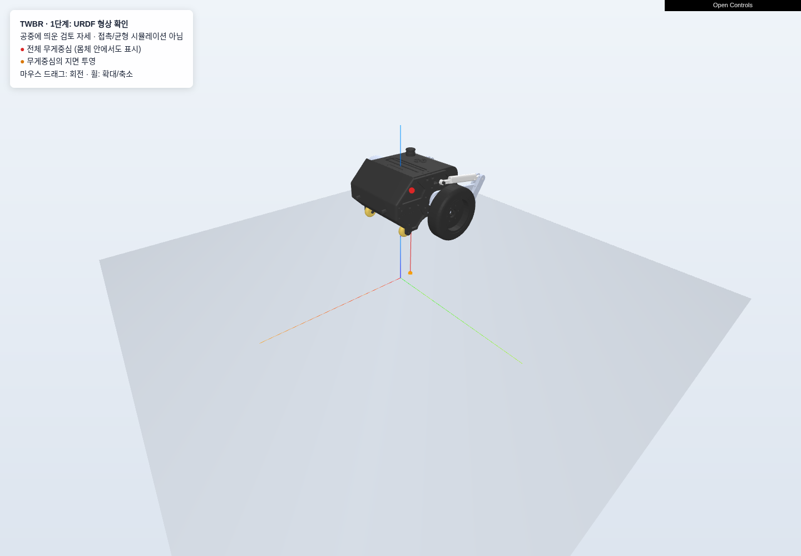

# TWBR

두 바퀴로 균형을 유지하는 로봇의 **URDF 기반 동역학 모델링** 프로젝트입니다.
모델 기반 균형 제어를 먼저 검증하고, 이후 학습 기반 보정으로 확장하는 것을 목표로 합니다.

현재는 Pinocchio로 기본 강체 동역학을 계산하고 MeshCat으로 형상·관절 움직임을 확인할 수 있습니다.
**지면 접촉, 폐루프 구속조건, 시간 적분 시뮬레이션, 균형 제어기는 아직 구현하지 않았습니다.**



*형상 검토를 위해 공중에 띄운 자세입니다. 빨간 점은 전체 무게중심, 주황 점은 지면 투영점입니다.*

## 진행 상태

| 구분 | 내용 |
|---|---|
| 완료 | URDF·메시 점검, 고정/부유 베이스 모델 로딩 |
| 완료 | 질량행렬 `M(q)`, 비선형항 `h(q,v)`, 중력항 `g(q)`, 전체 무게중심 계산 |
| 완료 | 수치 일관성 테스트 3개, 3D 시각화 및 관절 각도 조작 |
| 다음 작업 | 실제 링크 연동·구동 관절 확인 → 두 바퀴 접촉 자세와 정지 평형 검증 |
| 이후 작업 | 접촉 동역학·시뮬레이션 → 기본 균형 제어 → 모델 오차 검증 → 학습 기반 보정 |

연구할 접촉 상태는 **주행 바퀴 2개만 접촉하고 캐스터는 떠 있는 상태**입니다.
현재 URDF 총질량은 약 **4.949 kg**이며, 추가 장착 부품의 물성은 아직 검증·보정하지 않았습니다.

## 빠른 시작

저장소를 내려받은 뒤 루트 폴더에서 실행합니다. 아래 명령은 Linux 기준입니다.

```bash
python -m venv .venv
.venv/bin/python -m pip install -e '.[visualization]'

# 기본값: 부유 베이스, 영점 자세, 속도 0
.venv/bin/python scripts/compute_dynamics.py

# 3D 뷰어: 터미널에 출력된 주소를 브라우저에서 열기
.venv/bin/python scripts/view_robot.py

# 검증
.venv/bin/python -m unittest discover -s tests -v
```

뷰어가 필요 없으면 설치 명령에서 `'.[visualization]'` 대신 `.`을 사용합니다.
동역학 계산에는 ROS 설치가 필요하지 않습니다.

검증 환경: Linux x86_64 · Python 3.14.7 · Pinocchio 4.1.0 · NumPy 2.5.4 · MeshCat 0.3.2.
의존성은 [pyproject.toml](pyproject.toml)에 정의되어 있습니다.

## 코드 구성

```text
TWBR/
├── 2WL_V3_Assem_v2/       # 기존 URDF, STL 및 ROS 패키지 자료
├── src/twbr/modeling/
│   ├── loader.py         # URDF 로딩, 베이스 선택, 중력 설정
│   └── dynamics.py       # 상태에 따른 동역학 항 계산
├── scripts/
│   ├── compute_dynamics.py
│   └── view_robot.py
├── tests/test_model.py   # 모델의 수치 일관성 검증
├── docs/                 # 사용법, 모델 가정, 다음 작업
└── pyproject.toml
```

기존 로봇 패키지는 그대로 사용합니다. `.venv/`와 실행 시 생성되는 `outputs/`는 Git에 포함하지 않습니다.
미리보기 이미지 한 장만 `docs/images/`에 보관하며, 대용량 3D HTML과 계산 결과는 실행해서 생성합니다.

## 문서

- [실행 및 결과 해석](docs/usage.md): 계산 결과 저장, 뷰어 조작, Python 코드에서 재사용
- [모델 가정 및 검증 기록](docs/modeling_assumptions.md): 현재 물성, 검증 범위, 미확인 사항
- [다음 작업](docs/roadmap.md): 단계별 목표와 완료 기준
